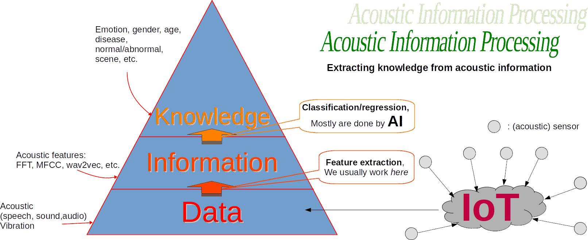
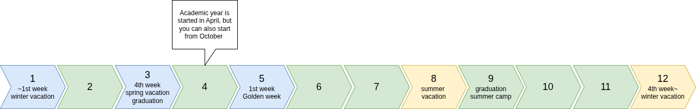

> Today's research defines tomorrow's world.  
> Research makes differences.



## Research Focus

My research goals are aimed at extracting knowledge from acoustic information (aka acoustic features). Examples of this theme include: speech emotion recognition, abnormal sound detection, and audio classification. Moreover, the research can be extended to vibration signals.

My approaches to achieve these goals are defined by: (1) data-driven approach (instead of physical modeling), (2) focus on practical implementation (instead of theoretical solutions), and (3) solving real problems/data (not just simulation). Another consideration is robustness (how stable/consistent the model is given any perturbation instead of correctness) and generalization (how well the model performs on unseen data).

For me, science should be evidence-based, implementable, and consistent. My research is result-oriented instead of process-oriented. This doesn't mean that the process (physical phenomena, modeling, math, and algorithms) is not important. If we understand the process very well, the solution may appear by itself. Still, there must be a reason (rationale) for doing such research. Then, I judge my research mainly based on the results.

My research contributes to developing technologies to solve issues in Society 5.0 (What is Society 5.0? [Read here in Indonesian language](http://bagustris.blogspot.com/2022/04/menuju-masyarakat-50-melalui-riset-dan.html)).

<!--- --->

## Research Areas

### Speech {#speech}

I study how machines can understand and produce human speech: recognizing speech and emotion, synthesizing expressive voices, and detecting health conditions from the voice.

[See speech publications](/publications/?theme=speech)

### Acoustics {#acoustics}

I study sound and vibration beyond speech, such as cough sounds, machine noise, acoustic scenes, and sound source separation.

[See acoustics publications](/publications/?theme=acoustics)

### Multimodal {#multimodal}

I combine audio with other information, such as text and video, to understand and generate human communication.

[See multimodal publications](/publications/?theme=multimodal)

### Research Journey

* {:.acoustics} **2005–2009, Bachelor's:** machine sound separation for fault detection
* {:.speech .acoustics} **2010–2012, Master's:** source segregation from binaural inputs
* {:.multimodal} **2018–2021, PhD:** speech emotion recognition from acoustic and linguistic information

## For Prospective Students


### Offered Research Themes

The following are past research themes that I offer: 

1. {:.speech} Speech emotion recognition using multilayer perceptron with CCC loss, dataset: IEMOCAP
2. {:.speech} Indonesian speech recognition using Wav2Vec2/Hubert/WavLM/UniSpeech-SAT, etc.
3. {:.speech} Toward universal acoustic features for multi-corpus speech emotion recognition, 30+ datasets.
4. Development of Calfem-Python
5. {:.acoustics} Development of Vibration Toolbox
6. {:.speech} Indonesian emotional speech synthesis using FastSpeech
7. {:.speech} COVID-19 diagnosis using SPEECH sound with deep learning, dataset: ComParE CSS 2021
8. {:.speech} Predicting pathological voice disorders with speech processing techniques, dataset: SVD, Voiced, HUPA
9. {:.speech} Detection of emotion intensity in non-speech sounds (laughter, crying, etc.)
10. {:.speech} Detecting/predicting stuttering (bahasa: gagap) in speech with machine learning
11. {:.multimodal} Predicting the intensities of seven self-reported emotions (Adoration, Amusement, Anxiety, Disgust, Empathic Pain, Fear, Surprise) from user-generated reactions to emotionally evocative videos
12. {:.speech} Few-shot learning on acoustic data to capture 10 dimensions of emotions reliably perceived in distinct vocal bursts: Awe, Excitement, Amusement, Awkwardness, Fear, Horror, Distress, Triumph, Sadness, and Surprise
13. {:.speech .multimodal} Multimodal learning (audio+video+text) to capture 10 dimensions of emotions reliably perceived in distinct vocal bursts: Awe, Excitement, Amusement, Awkwardness, Fear, Horror, Distress, Triumph, Sadness, and Surprise
14. {:.multimodal} Inferring self-reported emotions from multimodal expression, using multi-output regression to predict fine-grained self-report annotations of seven 'in-the-wild' emotional experiences

### Research Topics/Themes

Read my [papers](https://scholar.google.co.jp/citations?user=xuiLAewAAAAJ&hl=en). Usually, I write down the remaining tasks for future work in that topic.

For master's level, you can also propose your research theme. PhD students are expected to have a clear research direction and be able to work independently. 

### Style Guide

An example repository for ~~undergraduate~~ final projects can be seen [in this guide](https://github.com/bagustris/tugas-akhir).



### Teaching Policy

There are no specific requirements for master's students; however, doctoral students require **a publication** before enrollment, at minimum hosted in IEEE Xplore or equivalent. A strong background in signal processing and machine learning is a plus for student candidates. I prefer to supervise students who are highly motivated and passionate about research and previously have used either Nkululeko, Speechain, or [other my toolkits](https://github.com/bagustris). My research interests are speech, acoustics, and multimodal. PhD students should propose their themes independently. I choose practicability over novelty of research topics (but still, there should be contribution/novelty in research). Regular meetings (lab study, seminar, meeting) are keys to discuss progress, challenges, and next steps. Students are encouraged to actively **read** relevant literature, **do** experiments, and critically **analyze** the results. While research is important, health is also a priority, both physically and mentally. Ultimately, I aim to help students develop their research skills and contribute meaningfully to their field of study.

For undergraduate level, I will try to provide the baseline method, and you will improve the results using your proposed method.

### Typical Timeline

<!-- (/images/pengerjaan-ta.png) -->  
Green:  work hardest, play hard phases;  
Blue: work harder phases, play hard phases;  
Yellow: work hard, play harder phases  

The timeline is on a yearly basis; it can be adapted for undergraduate students (S1, last year), master's students (S2, 2 years), and PhD students (S3, three years of research from the beginning).

## Funding and Awards

### Research Grants

1. Simulation and prediction of Soekarno-Hatta Airport train noises (Funded by LPPM ITS 2017)
2. COVID-19 cross-dataset detection based on cough data with deep learning methods (TM/DRPM-ITS/PN.01.003, Funded by ITS 2022)
3. 音声の音源-調音分解を用いた自己教師あり表現学習 (Kakenhi B, 2024-2027)  
4. Leveraging ASR Technology for Japanese Language Learning and Paralinguistic Analysis (NAIST Senju Monju project FY2026/2027: Phase 1 Early-career Researcher Support Program))
5. Research grant with private company on speaker diarization FY2026/2027.

### Travel Grants

1. Travel grant for attending Hands-on School on Complex Systems and Data Science, ICTP (UNESCO/IAEA), Trieste, Italy, 2015.
2. Travel grant for attending Intensive Course on Management of Technology, MJIIT-UTM, Kuala Lumpur, Malaysia, 2014.
3. Travel grant for attending Workshop on Computational Science Infrastructure and Applications for Academic Development, ICTP (UNESCO/IAEA), Trieste, Italy, 2015.
4. Travel grant for attending Workshop on Advanced Techniques for Scientific Programming and Management of Open Source Packages, ICTP (UNESCO/IAEA), Trieste, Italy, 2016.
5. Travel grant for attending Workshop on Advanced Techniques for Scientific Programming and Management of Open Source Packages, ICTP (UNESCO/IAEA), Trieste, Italy, 2017.
6. NEC C&C International Conference Travel Grant 2019   
7. Partial grant for attending Advanced Workshop on Machine Learning in Citizen Science, ICTP (UNESCO/IAEA), Trieste, Italy, 2023.
8. FY2026 Senju Monju Project (Phase 3) Early-Career Researcher International Conference Presentation Support Program  

### Scholarships

1. PPA/BBM Scholarship 2005-2008 (ITS Indonesia)  
1. Bank BRI Scholarship 2008/2009 (ITS Indonesia)   
1. JASSO Scholarship 2011/10-2012/3 (Kumamoto University)  
1. MEXT Scholarship  2017/10-2021/3 (JAIST)
